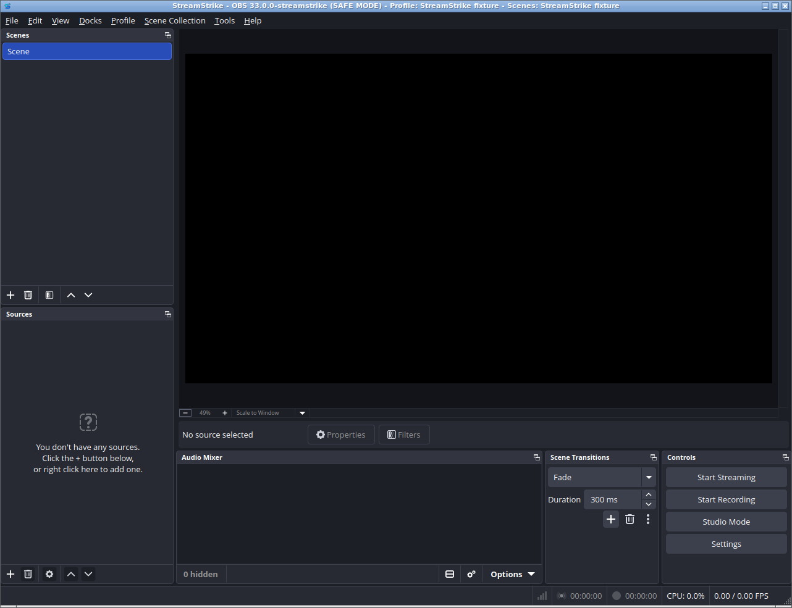

<p align="center">
  
</p>

<p align="center">
  <a href="https://prowebdevsolutions.com"><picture>
    <source media="(prefers-color-scheme: dark)" srcset="assets/branding/PWDS-logo-orange.svg">
    
  </picture></a>
</p>
<p align="center"><strong>Published by PWDS</strong></p>

<h1 align="center">StreamStrike</h1>

**Target: port the entire OBS Studio application to Rust while preserving its
original UI, features and behavior.** This is a source-by-source migration of
OBS, not a parallel replacement UI or a wrapper presented as a completed rewrite.

**Current state:** the running application still uses **the original C/C++ OBS
Studio frontend and libobs engine**, not the retired custom Rust project-editor
UI. A [bounded Rust scalar-settings parity module](docs/OBS_SCALAR_PARITY.md)
(`src/obs_scalar.rs`) implements boolean, string and numeric tier resolution,
but **is not yet integrated into the native OBS runtime**. The next migration
slice replaces the native boolean/string settings-read functions with Rust
implementations invoked by the existing OBS frontend, with original-source
parity and native-execution checks required before acceptance.

The pinned upstream source is
`obsproject/obs-studio` commit `72e86655715d9a25d69ce446aa4dd44ba58e10d2`
(OBS 33.0.0). Original C/C++ compilation passed in
[run 40045870669](https://github.com/Gerbzz/StreamStrike/actions/runs/40045870669).
The full Rust rewrite is therefore **not complete**. The bounded Linux UI
identity capture below verifies the current C/C++ baseline, not Rust migration
progress; recording, streaming, hardware, installers and release readiness are
not established by it.

## Current native OBS frontend — Linux



Unmodified native window captured on **2026-10-24**, from source
[`aa18f3bc`](https://github.com/Gerbzz/StreamStrike/commit/aa18f3bcb9cf696933e08e0116debc07bd15c18b)
in [hosted run 40121353686](https://github.com/Gerbzz/StreamStrike/actions/runs/40121353686).
The existing StreamStrike mark is verified in the actual application/window and
idle/active/paused tray readbacks; original OBS toolbar icons render correctly.
This is an isolated **Linux safe-mode, empty-scene** launch and normal close—not
a recording or streaming demonstration. [Source, hashes and scope](assets/screenshots/streamstrike-obs-linux-20261024.provenance.json).

## Default developer application: actual OBS with StreamStrike identity

The supported helper path currently targets Ubuntu 26.04. Prepare the toolchain
and dependencies required by the pinned upstream source, including CMake, Ninja,
Qt (including Ubuntu's `qt6-svg-plugins` runtime package), FFmpeg and CEF. This helper does not install system dependencies, invoke sudo,
or silently reduce frontend/browser functionality. The exact fully provisioned
hosted build remains in [obs-foundation.yml](.github/workflows/obs-foundation.yml).

```sh
python3 tools/obs_foundation.py fetch
python3 tools/obs_foundation.py build --cef-root "$PWD/foundation/obs-studio/.deps/cef_binary_7871_linux_x86_64"
python3 tools/obs_branding.py prepare
python3 tools/obs_branding.py build
python3 tools/obs_branding.py
```

Before building, use the pinned upstream dependency preparation to retain both
`.deps/cef_binary_7871_linux_x86_64.tar.xz` and its extracted directory inside the
original donor. The branded helper requires this exact checksum-verified archive
and canonical prepared location; an arbitrary external CEF directory is not its
ownership-provenance contract. The hosted workflow demonstrates the full setup.

The branding helper builds a separate tracked-source copy with a hash-locked overlay; the original donor and its original build remain unchanged. It wires the existing mark into the actual Qt window and all idle/active/paused tray states, retaining the OBS frontend and media engine. The bounded Linux gate above passed; future changes still require source-matched native verification, not source tests alone. [Overlay, validation and platform limits](docs/OBS_BRANDING.md).

`fetch` refuses an existing directory. `build` verifies the donor identity,
uses its original `ubuntu` CMake preset with browser support and relocatable runtime paths enabled, and installs
to the checkout-local `build_ubuntu/install/RelWithDebInfo`. The original helper’s no-argument
command (or `run`) launches only that original `bin/obs`, checking its source pin
and recorded build hash. The default branding command above separately verifies the complete copied source/overlay and its own executable receipt; it never falls back to the donor or legacy editor. If source, binary, receipt, dependencies or runtime are
missing, it fails explicitly; it never launches the old editor or system OBS.
`record-build` can stamp a preexisting executable: its receipt is only a local
identity check, **not proof that the binary was compiled from the pinned source**.
The verified hosted build and its provenance remain authoritative build evidence.
An executable-only loader check does not prove plugin readiness. The branded
helper additionally verifies installed ELF dependency closure and a complete
installed-file inventory; [the Linux install correction](docs/OBS_BRANDING.md#linux-developer-runtime-dependency-closure) remains part of the source-matched native gate.
Build concurrency honors `CMAKE_BUILD_PARALLEL_LEVEL` if set; otherwise CMake
uses the native generator default. Set that environment variable to a job count
appropriate for measured available CPU and memory; the helper imposes no fixed cap.

Windows/macOS source work should follow the pinned upstream platform build
instructions; this helper does not claim those platforms have passed acceptance.
Running OBS uses normal OBS settings/profile locations and can change them;
back up existing OBS profiles before developer testing. No legacy `.streamstrike`
project is automatically opened, converted, migrated or overwritten.

## Preserved legacy project compatibility

The old GUI entrypoint, GUI-only dependencies and screenshot workflow are retired.
Their code and captures remain recoverable in Git history; existing evidence and
artwork remain in the tree, labeled historical rather than current application UI.
The Rust project model, validation, atomic storage, document state and CLI remain
intact for compatibility with existing JSON `.streamstrike` projects:

```sh
cargo test --locked --all-targets
cargo run --locked --bin streamstrike -- show PATH.streamstrike
```

The CLI is **not** the application launcher or media engine. Its create/edit/save
commands are still available; they do not open media devices. No automatic OBS
importer exists yet: preserve originals and map unsupported fields explicitly in
a separate future conversion, writing new files rather than replacing user data.
See [the preservation audit](docs/OBS_CUTOVER.md) and
[OBS foundation direction](docs/OBS_FOUNDATION.md).

## Acceptance and licenses

Next gates are original OBS on a real desktop: display/microphone capture,
preview, bounded recording, stop/finalize, independent decode, and failure paths.
Compilation and launch-helper unit tests do not establish those results.
OBS retains its upstream GPL-2.0-or-later notices; all supplied upstream fixtures
and approved artwork are preserved. Distribution requires corresponding source,
build scripts and dependency notices. No first-party license grant or OBS Project
affiliation is claimed by this source checkpoint.

### PWDS publisher artwork

The company mark in this masthead is the existing [official PWDS logo](https://github.com/Gerbzz/PWDS-Website/blob/main/public/prowebdevsolutions-logo.png), with the [official orange display asset](https://prowebdevsolutions.com/images/prowebdevsolutions-logo-orange.svg) for dark backgrounds. This is PWDS publisher artwork, not a StreamStrike app logo.

## Product artwork

The StreamStrike product mark above has an original [SVG master](assets/branding/StreamStrike-logo.svg) and matching PNG. [Asset provenance](assets/branding/StreamStrike-logo.provenance.json) records how it was created and the exact file hashes. The PWDS publisher artwork and inherited software credits are unchanged. Historical screenshots retain the artwork visible in their original captured builds. The current image is the actual source-matched OBS frontend, reviewed after hosted capture—not the retired custom GUI.
